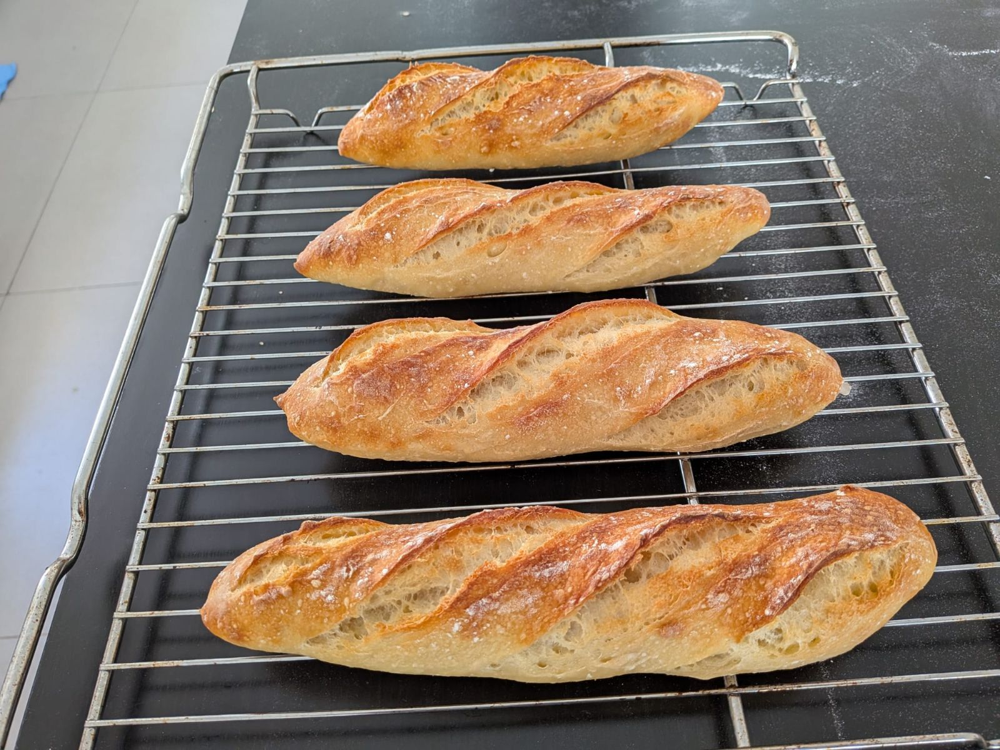
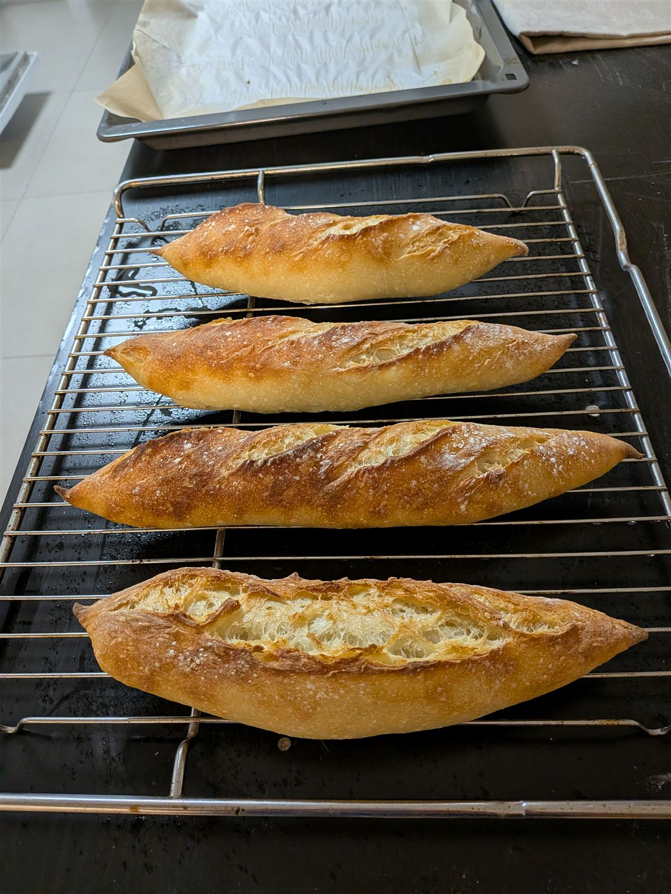
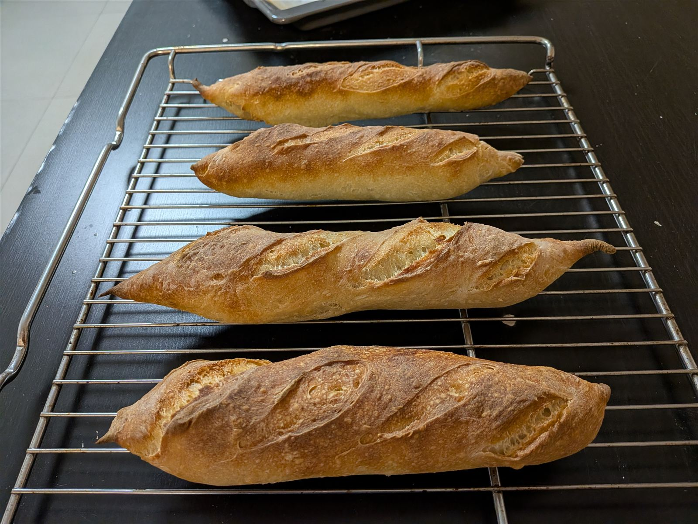

# Baguettes — bake log

## 2026-11-25

**Flour type:** T65

**Outdoor temp:** 18°C

**Humidity:** 71%

## 2026-11-23

**Flour type:** T65

**Outdoor temp:** 19°C

**Humidity:** 74%

## 2026-11-21

**Flour type:** T65

**Outdoor temp:** 20°C

**Humidity:** 66%

## 2026-11-13

**Flour type:** T65

**Outdoor temp:** 20°C

**Humidity:** 48%

## 2026-11-07

**Flour type:** T65

**Outdoor temp:** 18°C

**Humidity:** 88%

## 2026-11-06

**Flour type:** T65

**Outdoor temp:** 19°C

**Humidity:** 77%

