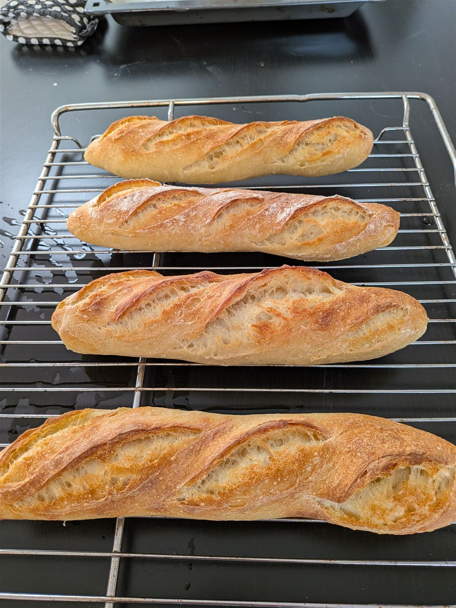
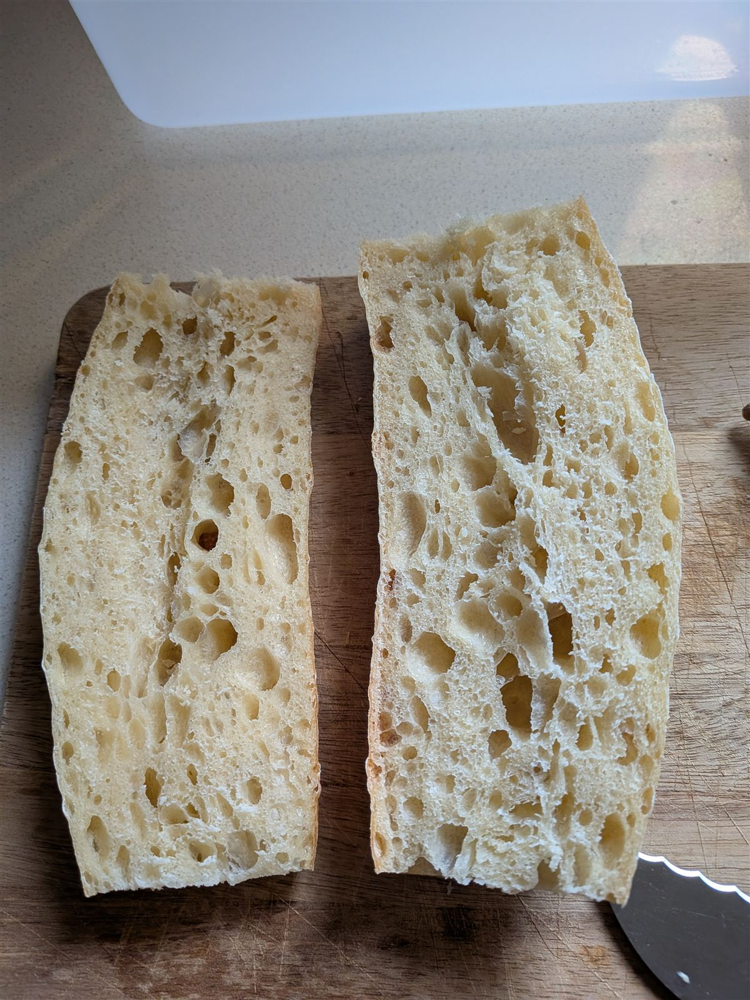

# Baguettes — bake log

## 2026-11-25

**Flour type:** T65

**Outdoor temp:** 15–23°C

## 2026-11-23

**Flour type:** T65

**Outdoor temp:** 15–24°C

## 2026-11-21

**Flour type:** T65

**Outdoor temp:** 15–26°C

## 2026-11-13

**Flour type:** T65

**Outdoor temp:** 13–28°C

## 2026-11-07

**Flour type:** T65

**Outdoor temp:** 17–20°C

## 2026-11-06

**Flour type:** T65

**Outdoor temp:** 17–23°C

