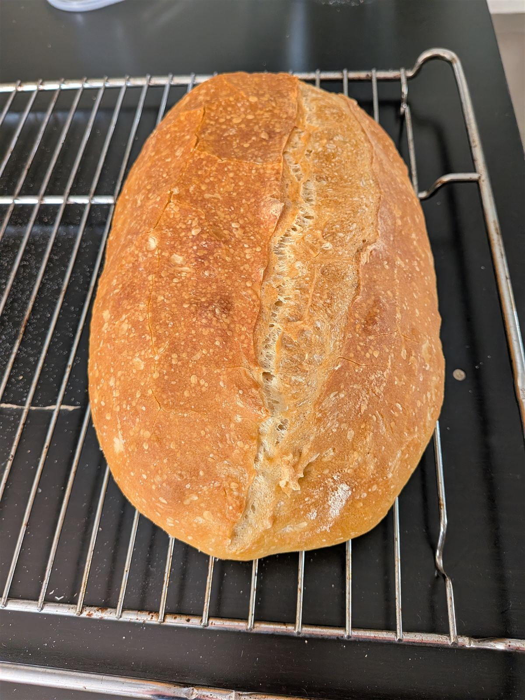
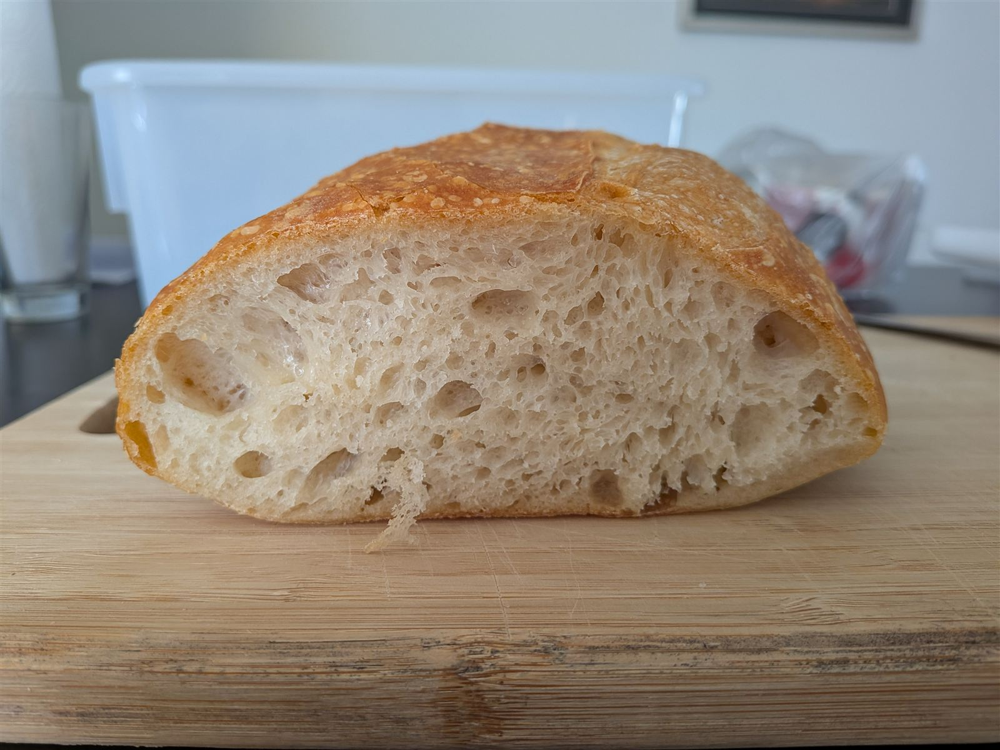
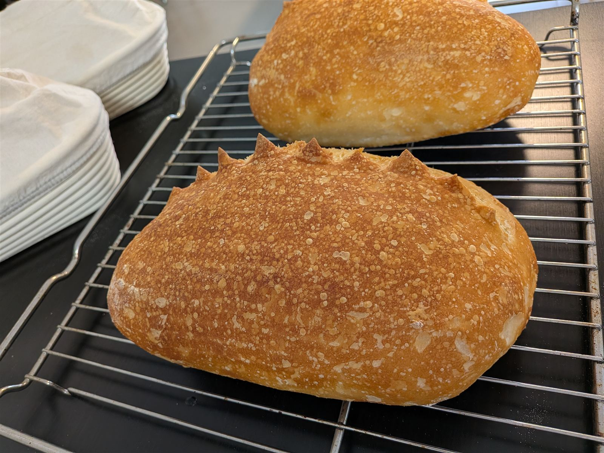
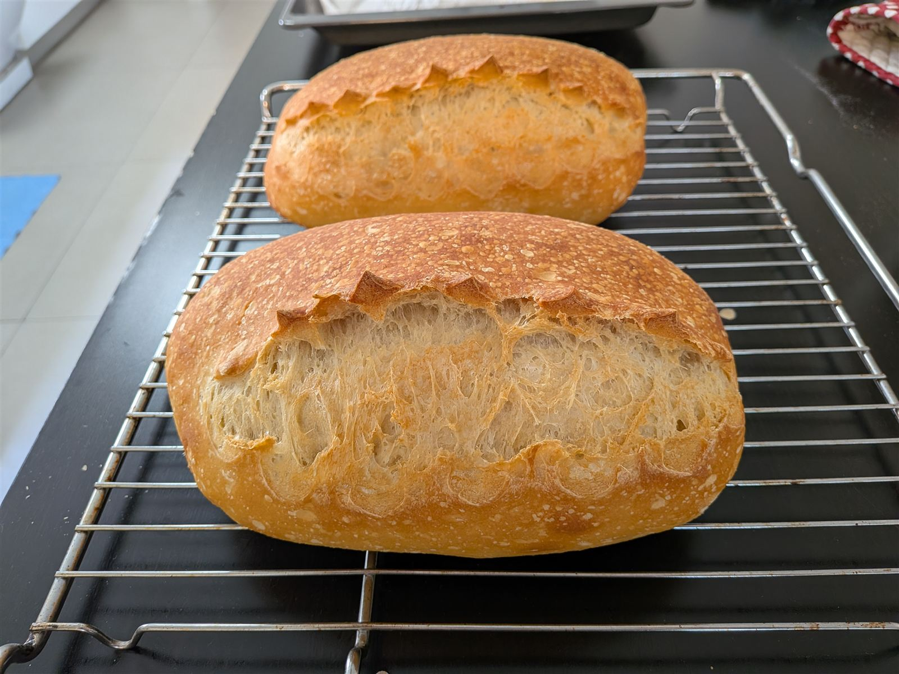
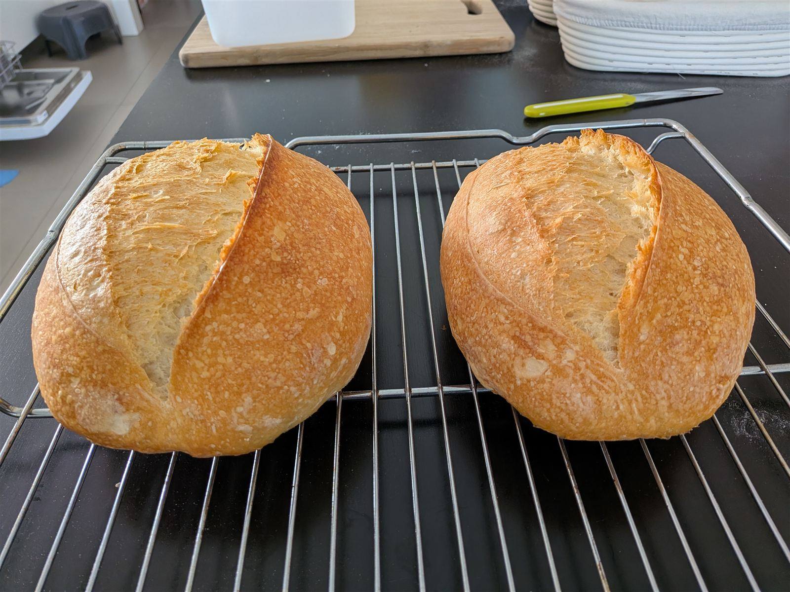
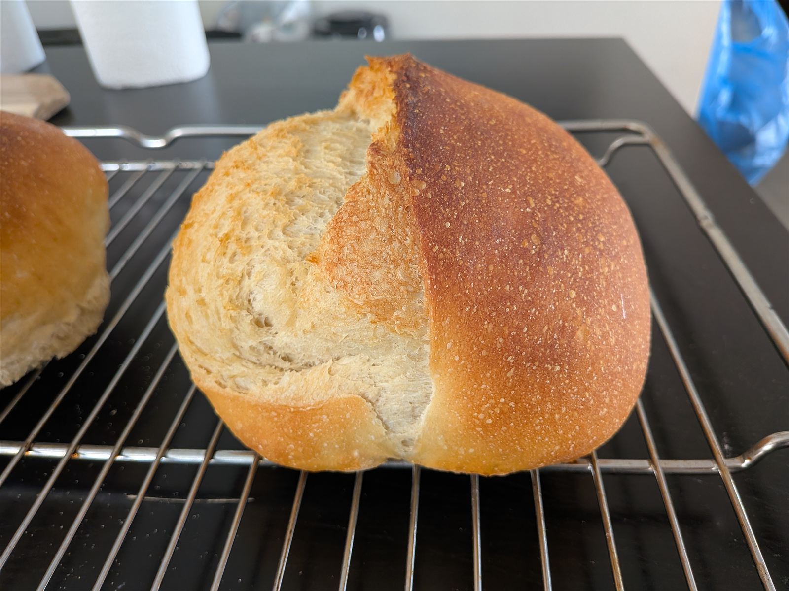

# Poolish Bread — bake log

## 2026-11-28

**Changes from the recipe:** 375 g water in the final dough instead of 360 g (about 72% hydration instead of 70%)

**Flour type:** Tamanini Manitoba Tipo 0 (W 390–410, P/L 0.70–0.90, 14% protein)

**Times:** Cold retard about 20 hours

**Outdoor temp:** 19°C

**Humidity:** 84%

**Notes:** OK, but not great. No ear; I think the shaping was bad. Taste not very deep: maybe the poolish should go longer, or a longer cold retard. Crumb was good, so I don't think it was under-fermented. Maybe the flour isn't amazing either.

## 2026-10-20

**Flour type:** bread flour

**Outdoor temp:** 21°C

**Humidity:** 62%

## 2026-07-18

**Flour type:** bread flour

**Outdoor temp:** 27°C

**Humidity:** 71%

## 2026-05-16

**Flour type:** bread flour

**Outdoor temp:** 21°C

**Humidity:** 71%

## 2026-04-17

**Flour type:** bread flour

**Outdoor temp:** 24°C

**Humidity:** 57%

